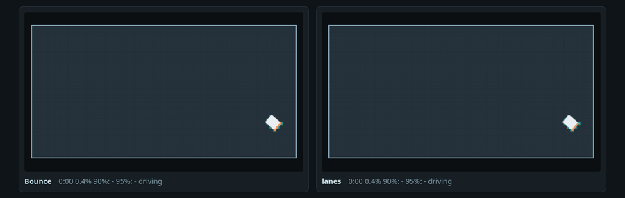
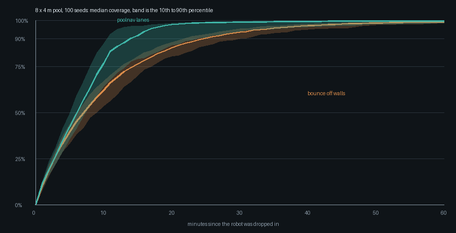

# poolnav



Navigation code for a pool cleaning robot that has no camera, no lidar and no position fix, only a gyro and the current of its two track motors. It sweeps lanes where a typical cleaner bounces around at random. The controller is `no_std` Rust, takes 4.3 KB of flash on an RP2040, and ships with a 2D simulator and a [browser demo](https://tahakocp.github.io/poolnav/) that runs the same code as WebAssembly.

Everything below is simulation. Nothing here has been in water. See [what is not checked](#what-is-not-checked).

| 8 x 4 m rectangular pool, median of 200 runs | bounce off walls | poolnav lanes |
|---|---|---|
| 90% of the floor cleaned | 25.0 min | 13.8 min |
| 95% | 33.0 min | 16.9 min |
| 99% | 56.8 min | 31.7 min |

Pools that are not rectangles get less out of it, and a curved pool gets nothing. Numbers for all four test pools are further down.

## Why this exists

Robotic pool cleaners cost $400 to $1,500, and the reports on r/pools are mostly about two things: they get stuck on ledges ([example](https://www.reddit.com/r/pools/comments/1p1kp29/aiper_surfer_s2_stuck_and_weak_motor_issue/)) and they die a few weeks after the warranty ends, with a $270 to $420 repair quote on a $370 to $800 machine ([1](https://www.reddit.com/r/pools/comments/1exz0lz/maytronics_dolphin_pool_robot_lifespan/), [2](https://www.reddit.com/r/pools/comments/1khl6ih/repair_dolphin_or_new_robot_cleaner/)). Someone who wants to rebuild a dead one around an ESP32 or RP2040 finds almost nothing to start from. GitHub search for pool cleaning robots returns a handful of repos with zero stars. The most useful one, [Steve2017/Pool-Cleaning-Robot-ESPHome](https://github.com/Steve2017/Pool-Cleaning-Robot-ESPHome), retrofits a Zodiac OT-30 with tilt sensors and timers, which is the usual commercial approach: drive, hit a wall, reverse, try a new direction.

poolnav is the missing middle part: given a gyro and two current readings, decide what the tracks do.

## Try it

- Browser: <https://tahakocp.github.io/poolnav/>. Pick a pool, change gyro bias and track slip, watch both strategies from the same start.
- Native, needs a Rust toolchain:

```
git clone https://github.com/tahakocp/poolnav && cd poolnav
cargo run --release -p poolsim -- bench --seeds 50 --pool rect --variant random --variant lanes
cargo run --release -p poolsim -- trace rect lanes 3 30 > path.csv
cargo test --release
```

Release binaries (Linux x86_64 bench tool, the wasm module) are on the [releases page](https://github.com/tahakocp/poolnav/releases).

## How the controller works

It has to work without ever knowing where it is, so it leans on the walls.

1. Heading comes from integrating the gyro. While driving forward it holds the heading it started the run with, otherwise a few percent of difference in track speed bends every lane.
2. A wall shows up as motor current above a threshold for 0.3 s. A single spike (a ripple on the floor) is ignored.
3. In lane mode the robot keeps pushing into the wall for about a second. The tracks end up flush against it, so the heading at that moment is a multiple of 90 degrees relative to the first wall it touched. The controller snaps its integrated heading to that grid. This removes the accumulated gyro drift at every wall, which is the main reason lanes stay straight.
4. While pinned and not rotating, the true yaw rate is zero, so whatever the gyro reports is its bias. That is averaged into a bias estimate. The gate matters: while the body is still squaring itself to the wall it does rotate, and the first version of this learned a bias of 16 degrees per second from that. A unit test pins the fix.
5. Start: drive to a wall, turn left, drive to the corner. Then sweep wall to wall, step sideways by a little less than the body width, sweep back. A sideways step that hits a wall means the lanes are used up.
6. Second pass: go back to a corner and do the same at right angles. The gaps left by slip and timing errors in pass one are not in the same places as the gaps in pass two.
7. If the snap residual at some wall is more than about 17 degrees, that wall is not square to the first one. Lanes make no sense then and the controller falls back to bouncing for the rest of the run.
8. If the body cannot turn because a wall is too close, it backs off, and if that is blocked too it goes forward and turns the other way round.

The simulator gives it a rectangle body of 40 x 30 cm, tracks at 0.25 m/s nominal, a per-run speed error, gyro bias with a random walk, and wall contact that squares the body to the wall at 45 degrees per second. A cell counts as clean when its centre is under the body. Cells the body can never reach (the tips of a stair corner for instance) are left out so they do not cap every strategy.

## Results

200 runs per row, random drop-in position and heading, 2 hour cap, medians in minutes. The 99% mark is reached in roughly 90% of runs inside the cap; the others were still just short of it.

| pool | bounce 90% / 95% | lanes 90% / 95% |
|---|---|---|
| `rect` 8 x 4 m | 25.0 / 33.0 | 13.8 / 16.9 |
| `l-shape` | 26.0 / 35.7 | 16.5 / 24.1 |
| `steps` 9 x 4.5 m, stair corner and a ladder base | 29.7 / 40.2 | 28.0 / 38.6 |
| `kidney` curved | 22.5 / 31.1 | 23.3 / 32.7 (lanes dropped) |



What each piece is worth, rectangular pool, minutes to 95%:

| variant | 95% |
|---|---|
| full | 16.9 |
| one pass only | 24.2 |
| no wall snap | 29.3 |
| no bias learning | 26.0 |
| bounce | 33.0 |

Snapping to the wall grid is worth the most. Without it lanes drift and barely beat bouncing.

Sensitivity, 100 runs, minutes to 95% (rect / l-shape, bounce vs lanes):

| change | bounce | lanes |
|---|---|---|
| default | 33.0 / 35.7 | 16.9 / 24.1 |
| gyro bias 2 deg/s instead of 0.5 | 33.3 / 35.5 | 22.2 / 32.0 |
| 20% speed error instead of 8% | 42.0 / 41.5 | 33.4 / 38.1 |
| wall alignment 15 deg/s instead of 45 | 34.4 / 36.8 | 19.2 / 30.3 |

A robot with sloppy tracks keeps most of the gain in a rectangle and loses it in an L. Raw CSVs are in `docs/data/`.

## Using it in firmware

```rust
use navcore::{Config, Nav, Sensors, Strategy};

let mut nav = Nav::new(Config::new(Strategy::Lanes), 0xC0FFEE);
loop {
    // every 100 ms
    let drive = nav.step(
        &Sensors { gyro_z: gyro_rad_s, current_left: i_left, current_right: i_right },
        0.1,
    );
    set_tracks(drive.left, drive.right); // -1.0 .. 1.0
}
```

Currents must be scaled so a free-running track reads well under `contact_current` (0.7) and a stalled one above it. `Config` has the other knobs. `scripts/size.sh` builds a probe for `thumbv6m-none-eabi` and links it with garbage collection: 4,322 bytes of flash and 92 bytes of static RAM, soft float included.

## What is not checked

- No real robot, no water. Speeds, slip, noise and the wall alignment behaviour are assumptions in a plausible range. The sensitivity table shows which ones matter most; if a real robot does not square itself to the wall under push, the snap step loses its footing.
- Current thresholds depend on the motor and the supply. Wall detection on real hardware needs a calibration step that does not exist here.
- Waterline climbing, the cable, hydrodynamic drag, sloped floors and drains are not modelled.
- Pools are polygons in 2D. Free-form shapes with long curved walls fall back to bouncing.
- The L-shaped and stepped pools only partly benefit. Lanes end at the first sideways step that hits a wall, which in those shapes is often not the far wall. That is my reading of the traces, I have not tested a fix.

If you own a robot and can log gyro and motor current from a run, that data would settle most of the list above. Open an issue with the log.

## Layout

```
navcore/     the controller, no_std, no dependencies
sim/         pools, robot model, bench / curve / trace commands, tests
web/         C interface over the simulator, built to wasm
site/        the demo page (plain JS, loads the wasm)
size-probe/  tiny staticlib used to measure the MCU build
scripts/     size.sh, plot.py for the chart
```

MIT license.
